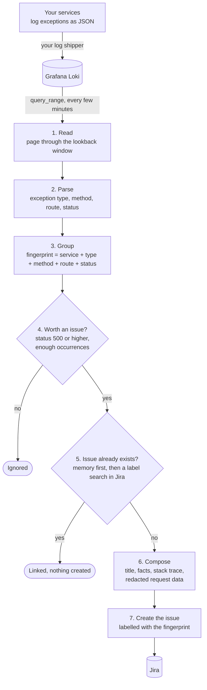
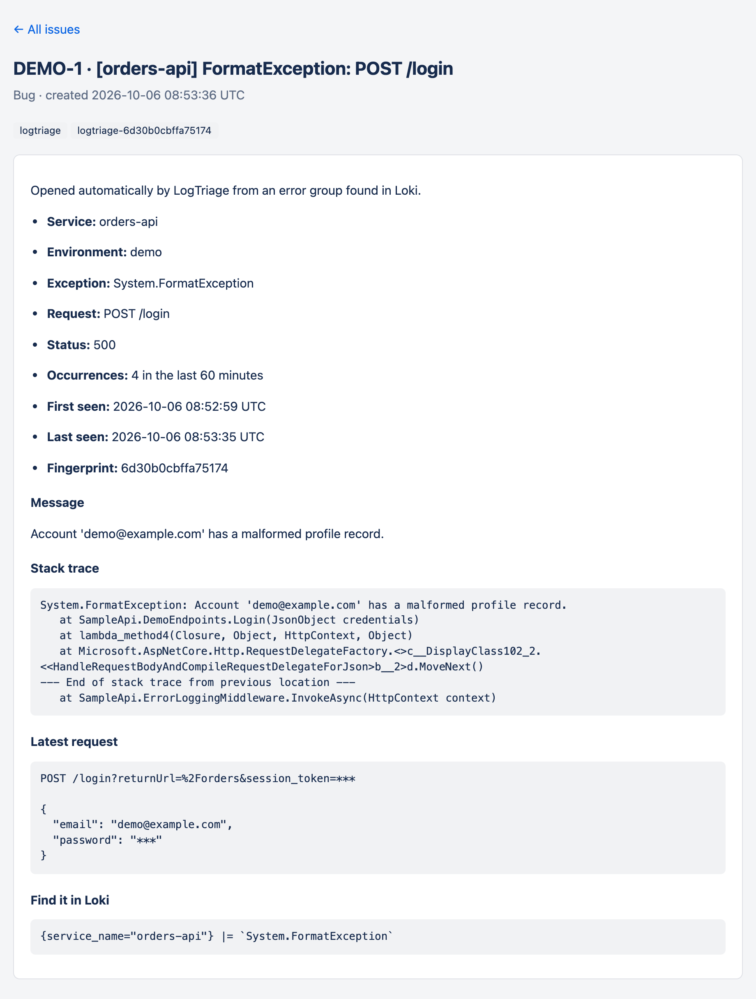

# LogTriage

**Turns the errors in your Grafana Loki logs into Jira issues: one issue per distinct error, opened automatically, never twice.**

Your services already log their exceptions and Loki already stores them. LogTriage is a small .NET service that reads those logs, works out which lines are the same error, and makes sure each error has exactly one issue in Jira, with the stack trace, the failing endpoint and how often it happens.

It has no database, no agent and no SDK to install in your services.

## Why

If your team runs Loki and Grafana, errors are easy to *find* but nobody is *told* about them: someone has to open a dashboard, notice a new exception, check whether it is already known, and write the ticket by hand. A dedicated error tracker solves that, but it is another system to run and another SDK in every service.

LogTriage covers the gap with what you already have:

- **Groups** log lines into errors by service, exception type, HTTP method, route and status code.
- **Opens one issue per group**, and finds the existing one on later runs, so a thousand occurrences are still one ticket.
- **Writes a useful ticket**: title, occurrence count, first and last seen, message, stack trace, and a LogQL query to find the lines again.
- **Protects what it forwards**: request data is left out unless you ask for it, and then passwords and tokens are masked and anything that looks like payment data is withheld.
- **Starts in dry-run mode**, so you see what it would open before it opens anything.

## How it works



1. **Read.** Every `Sync:IntervalSeconds` the worker runs your LogQL query over the last `Sync:LookbackMinutes` and pages through the result.
2. **Parse.** Each line is read as JSON. A line without an exception type is not an error and is skipped.
3. **Group.** A fingerprint is computed from the service, exception type, HTTP method, route and status code. Message and stack trace are left out on purpose, so a different order id in the message or a shifted line number does not create a new group.
4. **Filter.** By default only groups with status 500 or higher qualify. Errors without an HTTP status always qualify.
5. **Deduplicate.** Every issue carries the label `logtriage-<fingerprint>`. If Jira already has an issue with that label, nothing is created. That label is the only state LogTriage needs, which is why it has no database and survives restarts.
6. **Compose.** The issue is written from the latest occurrence of the group.
7. **Create.** At most `Sync:MaxIssuesPerRun` issues are opened per run, most frequent errors first, so a bad deploy cannot flood your board.

[docs/how-it-works.md](docs/how-it-works.md) goes through each step in detail.

## Try the demo

The demo runs four containers: a sample API that fails on purpose, Loki, LogTriage, and a small stand-in for Jira so you need no account.

```bash
docker compose up --build
```

Open <http://localhost:8081>. Within about a minute three issues appear, one per failing endpoint, and they stay three no matter how long you leave it running. A fourth endpoint returns 404 and is ignored, because only server errors qualify.

The demo also shows the redaction. Open the `POST /login` issue: the password in the request body is `***`. Open the `POST /payments` issue: the request is withheld entirely, because the sample sends a test card number.

<p align="center">
  
</p>

To see the groups LogTriage is tracking:

```bash
curl -H "X-Api-Key: demo" http://localhost:8080/api/groups
```

<details>
<summary>Without Docker</summary>

You need the .NET 10 SDK and a Loki you can reach. In three terminals:

```bash
ASPNETCORE_URLS=http://localhost:8081 dotnet run --project samples/FakeJira

ASPNETCORE_URLS=http://localhost:8082 Loki__Url=http://localhost:3100 \
  Demo__Traffic=true Demo__BaseUrl=http://localhost:8082 dotnet run --project samples/SampleApi

ASPNETCORE_URLS=http://localhost:8080 Loki__Url=http://localhost:3100 \
  Sync__DryRun=false Sync__IntervalSeconds=15 \
  Jira__BaseUrl=http://localhost:8081 Jira__Email=demo@example.com Jira__ApiToken=demo-token Jira__ProjectKey=DEMO \
  Issue__IncludeRequestData=true Api__Key=demo dotnet run --project src/LogTriage
```

</details>

## Connect your services

LogTriage needs one thing from a service: when a request fails, log **one JSON line** that says what failed. The field names follow the OpenTelemetry semantic conventions.

```json
{
  "level": "error",
  "exception.type": "System.InvalidOperationException",
  "exception.message": "Order 41 has no shipping address.",
  "exception.stacktrace": "System.InvalidOperationException: Order 41 has no shipping address.\n   at Orders.Get(Int32 id)",
  "http.request.method": "GET",
  "http.route": "/orders/{id}",
  "url.path": "/orders/41",
  "http.response.status_code": 500
}
```

Only `exception.type` is required. The service name comes from the stream's `service_name` label and the environment from its `env` label.

For ASP.NET Core, [samples/SampleApi/ErrorLoggingMiddleware.cs](samples/SampleApi/ErrorLoggingMiddleware.cs) is a complete middleware you can copy: about sixty lines, no dependencies, and it works with any logging provider. For other stacks, emit the same fields with your own logger.

If your logs already have a different shape, you do not have to change them. Every field name is configurable, nested JSON works, and fields sent as Loki structured metadata are picked up too. See [docs/log-contract.md](docs/log-contract.md).

## Run it against Jira

1. **Start with a dry run.** Point LogTriage at your Loki and leave everything else alone:

   ```bash
   docker build -t logtriage .
   docker run --rm -p 8080:8080 -e Loki__Url=http://your-loki:3100 logtriage
   ```

   The log now lists every issue it *would* open. Adjust `Loki:Query` and the `Sync` settings until that list is what you want on your board.

2. **Create an API token** for the Jira account the issues should come from, ideally a dedicated service account. It needs permission to browse the project and create issues, and to assign issues if you set an assignee.

3. **Switch it on.** Copy [.env.example](.env.example) to `.env`, fill in the Jira settings, set `Sync__DryRun=false`, and run:

   ```bash
   docker run -d --name logtriage --env-file .env -p 8080:8080 logtriage
   ```

   If you have a backlog of old errors you do not want tickets for, set `Sync__NotBefore` to the current time first. Only errors seen after that moment get an issue.

Run a single instance. Two instances started at the same moment could each open an issue for the same new error.

## Configuration

Settings are read from environment variables (`Section__Name`) or `appsettings.json` (`Section:Name`). The ones you will most likely touch:

| Setting | Default | What it does |
| --- | --- | --- |
| `Loki:Url` | `http://localhost:3100` | Where Loki is. |
| `Loki:Query` | ``{service_name=~`.+`} \|= `exception.type` `` | The LogQL query that returns your error lines. Narrow it to one environment or team here. |
| `Sync:DryRun` | `true` | Report only. Set to `false` to create issues. |
| `Sync:IntervalSeconds` | `300` | How often the worker runs. |
| `Sync:LookbackMinutes` | `60` | How far back each run reads. |
| `Sync:MinStatusCode` | `500` | Groups with a lower HTTP status are ignored. |
| `Sync:MinOccurrences` | `1` | Occurrences needed inside the lookback window. |
| `Sync:MaxIssuesPerRun` | `5` | Upper bound on issues opened per run. |
| `Sync:NotBefore` | empty | Ignore groups last seen before this time (ISO 8601). |
| `Jira:BaseUrl`, `Jira:Email`, `Jira:ApiToken` | empty | Jira Cloud site and credentials. |
| `Jira:ProjectKey`, `Jira:IssueType` | empty, `Bug` | Where issues go and what they are. |
| `Jira:AssigneeAccountId`, `Jira:ParentKey` | empty | Optional assignee and epic. |
| `Issue:TitleTemplate` | `[{service}] {exceptionType}: {method} {route}` | The issue title. |
| `Issue:IncludeRequestData` | `false` | Add the latest request's query string and body, redacted. |
| `Api:Key` | empty | Enables `GET /api/groups` and is expected in the `X-Api-Key` header. |

The full list, including field mapping and Loki authentication, is in [docs/configuration.md](docs/configuration.md).

## Safe by default

- **Dry run is on** until you turn it off.
- **Request data is off** until you turn it on. When it is on, values of fields whose name contains `password`, `token`, `secret` and similar words are replaced with `***`, and a request that contains a card number or an IBAN is withheld entirely.
- **The API is off** until you set a key, and it is read-only.
- **Credentials come from the environment.** Nothing secret is read from a file in this repository.

Redaction is best effort. It cannot recognise every secret, and stack traces and exception messages are forwarded as they were logged. If your logs may contain data that must not reach your issue tracker, keep `Issue:IncludeRequestData` off and review what your services put into exception messages.

## Limitations

- **Jira Cloud only.** The tracker uses REST API v3 and Atlassian Document Format. Jira Data Center is not supported.
- **Built for HTTP services.** Errors without a method and route are grouped by service and exception type alone, which is coarse for background jobs.
- **One issue per error, ever.** A closed issue is not reopened when the error returns. Remove the `logtriage-…` label from the old issue if you want a new one next time.
- **Each run reads the whole lookback window.** With very noisy services, narrow `Loki:Query` or shorten the window. Reads stop at `Loki:MaxEvents` lines and report that the result was truncated.
- **Routes are best logged as templates.** Without `http.route`, LogTriage derives one from the path by replacing numeric, GUID and long hexadecimal segments with `{id}`. Other identifier formats end up as separate groups.

## Project status

Version 0.1, early. The pipeline is covered by unit tests and has been run end to end against Loki 3.7 with the bundled Jira stand-in. Use the dry run to check it against your own logs before letting it create issues.

## Development

```bash
dotnet build
dotnet test
```

| Folder | Contents |
| --- | --- |
| `src/LogTriage` | The service: Loki reader, grouping, redaction, issue composer, Jira client, worker and API. |
| `tests/LogTriage.Tests` | Unit tests. |
| `samples/SampleApi` | A failing API with the reference logging middleware. |
| `samples/FakeJira` | The stand-in for Jira used by the demo. |

The service has no third-party runtime dependencies. Contributions are welcome; see [CONTRIBUTING.md](CONTRIBUTING.md). To report a vulnerability, see [SECURITY.md](SECURITY.md).

## Read more

- [Your errors are sitting in Loki. Who's looking at them?](https://medium.com/@ferhatblnk/your-errors-are-sitting-in-loki-whos-looking-at-them-cf200c590bcc): why LogTriage exists and the decisions behind it.
- [Hatalar Loki'de duruyor, peki onlara kim bakıyor?](https://medium.com/@ferhatblnk/hatalar-lokide-duruyor-peki-onlara-kim-bak%C4%B1yor-33532ab581b0): the same article in Turkish.

## License

[MIT](LICENSE). The software is provided as is, without warranty of any kind.

LogTriage is an independent open-source project. It is not affiliated with, endorsed by or supported by Grafana Labs or Atlassian. Grafana and Loki are trademarks of Grafana Labs; Jira is a trademark of Atlassian.
