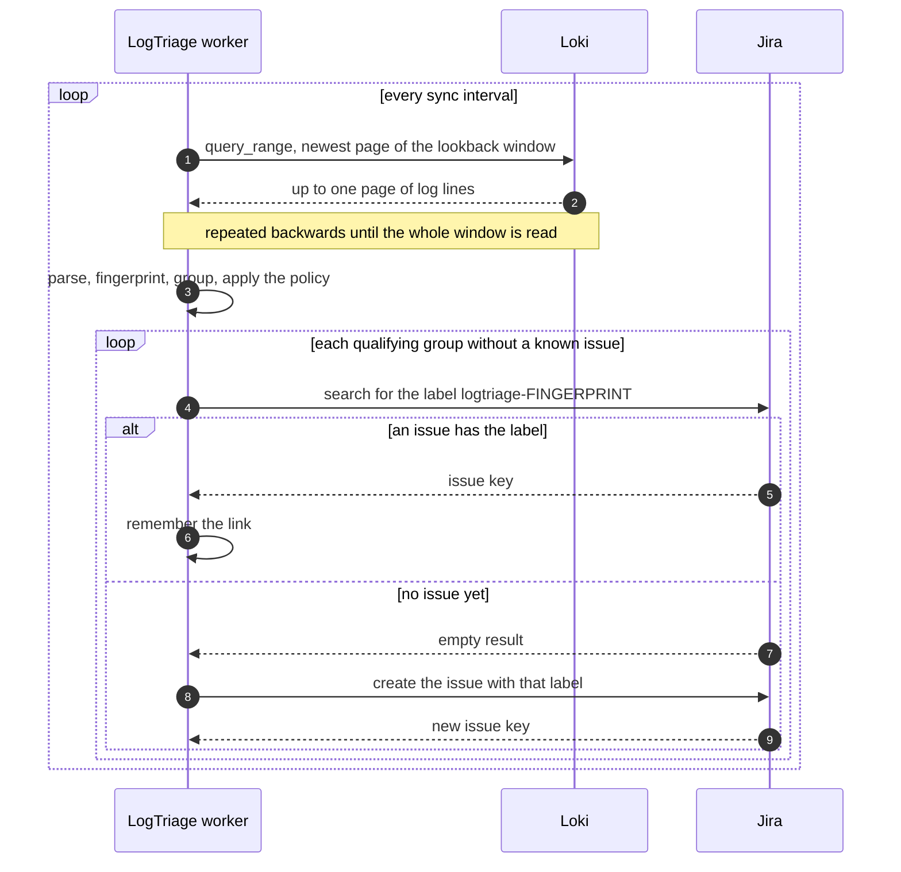

# How it works

LogTriage is one loop. On every interval it reads the recent errors from Loki, groups them, and makes sure each group that qualifies has exactly one issue. Nothing is stored between runs except a small in-memory map of the issues it already knows about.



## 1. Reading from Loki

The worker calls `GET /loki/api/v1/query_range` with the query in `Loki:Query`, over the window from `now - Sync:LookbackMinutes` to `now`, newest lines first.

Loki returns a limited number of lines per request, so the window is read in pages of `Loki:PageSize`. Each page ends where the previous one stopped. Lines that share the exact timestamp at a page border are requested again and matched against the ones already read, so none is lost and none is counted twice.

Reading stops after `Loki:MaxEvents` lines. The result is then marked as truncated: counts are lower bounds and the oldest errors in the window may be missing. The sync log line and `GET /api/groups` both report it.

The load on Loki is one query per page, per run. The cheapest way to keep it low is a selective query: filter on the stream labels of the services you care about and keep a line filter such as ``|= `exception.type` `` so Loki discards everything else before returning it.

## 2. Parsing

Each line is expected to be a JSON object. For every field (exception type, message, stack trace, method, route, path, query, body, status code) the parser looks, in this order:

1. inside the object named by `Fields:Root`, if one is configured;
2. at the top level of the JSON line, where the name may be a flat key (`"exception.type"`) or a path through nested objects (`exception` → `type`);
3. in the labels of the stream, with every character that is not a letter or digit replaced by `_` (`exception_type`). This is how fields sent as Loki structured metadata are found.

A line without an exception type is not an error and is skipped. That makes the query forgiving: it may return more than errors.

The service name is the value of the stream label named by `Loki:ServiceLabel`, the environment the one named by `Loki:EnvironmentLabel`.

## 3. Grouping

Two occurrences are the same error when they share a fingerprint. The fingerprint is the first 16 hex characters of the SHA-256 of:

```
service
exception type
HTTP method
route
status code
```

The exception message and the stack trace are **not** part of it. Messages usually contain identifiers (`Order 41 has no shipping address`), and stack traces change with every deploy; including either would open a new issue for an old error.

The route should be the route template (`/orders/{id}`). When a service logs only the raw path, a route is derived from it by replacing numeric, GUID and long hexadecimal segments with `{id}`.

Each group keeps the number of occurrences in the window, the first and last time it was seen, and the latest occurrence, which supplies the message, stack trace and request shown in the issue.

## 4. Deciding what deserves an issue

A group qualifies when all of these hold:

- its status code is at least `Sync:MinStatusCode` (500 by default), or it has no status code at all;
- it occurred at least `Sync:MinOccurrences` times in the window;
- it was last seen at or after `Sync:NotBefore`, when that is set.

Qualifying groups are handled most frequent first, and a run opens at most `Sync:MaxIssuesPerRun` issues. The rest are picked up by the following runs. If a deploy breaks fifty endpoints, the board fills gradually, starting with the errors that hurt most.

## 5. Making sure there is only one issue

Every issue LogTriage creates is labelled `logtriage-<fingerprint>`. Before creating one, it searches Jira for that label:

- **found**: the group is linked to the existing issue and nothing is created. The state of the issue does not matter; a closed issue still counts.
- **not found**: the issue is created.

The answer is remembered in memory, so Jira is asked once per group, not once per run. After a restart the memory is empty and the answers come back from the label search. This is the whole persistence story: the tracker itself is the record of what has been reported.

Two consequences are worth knowing:

- To get a fresh issue for an error whose old issue was closed, remove the fingerprint label from the old issue.
- Run a single instance. Jira's search index can lag a moment behind a newly created issue, so two instances seeing the same new error at the same time could both create one.

## 6. Composing the issue

**Title.** `Issue:TitleTemplate` with the placeholders filled in, for example `[orders-api] InvalidOperationException: GET /orders/{id}`. The exception type is shortened to its last segment; `{exceptionFullType}` gives the full name. The title is cut at 255 characters, Jira's limit.

**Description.**

- the facts of the group: service, environment, exception, request, status, occurrences in the window, first and last seen, fingerprint;
- the message and the stack trace of the latest occurrence (the stack trace is cut at `Issue:MaxStackTraceLength`);
- the latest request, only when `Issue:IncludeRequestData` is on;
- a LogQL query that finds the error in Loki again.

**Request data.** When included, the query string and body of the latest request go through two checks first:

1. If either contains a card number (13 to 19 digits, a first digit that card networks use, and a valid Luhn checksum) or a compact IBAN with a valid checksum, the request is withheld and the issue says so.
2. Otherwise, the value of every field whose name contains one of `Issue:SensitiveKeys` is replaced with `***`: in JSON bodies at any depth, in query strings, and by pattern in bodies that are not valid JSON (form posts, truncated JSON).

Both checks err on the side of hiding too much. They are still best effort, which is why request data is off by default.

## 7. When something fails

- **Loki is unreachable or rejects the query.** The run is abandoned, a warning is logged, and the next interval tries again.
- **Jira is unreachable or rejects a request.** Same: the run stops at that group and the next interval starts over. Issues created earlier in the run are found through their label.
- **The service restarts mid-run.** Nothing is half-written. The next run finds existing issues by label and continues.

## Dry run

With `Sync:DryRun` on (the default), steps 1 to 4 run as usual and step 5 is replaced by a log line per group: `Dry run: would open "…"`. Jira is not contacted and needs no configuration. Each group is announced once, at the same pace real issues would be opened, so the log reads like a preview of your board.
